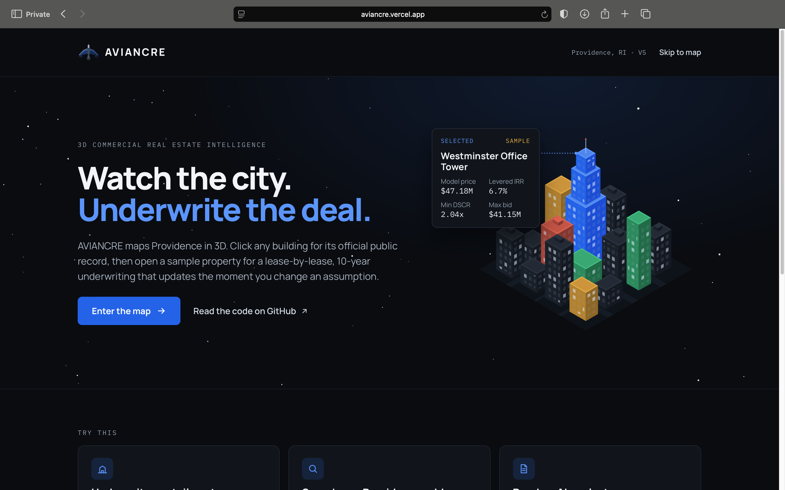
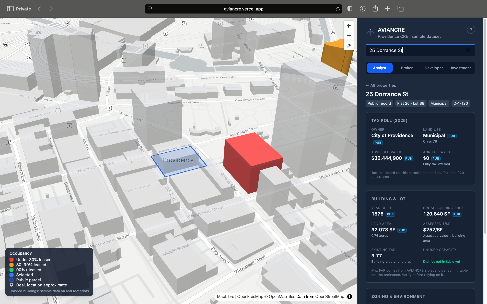
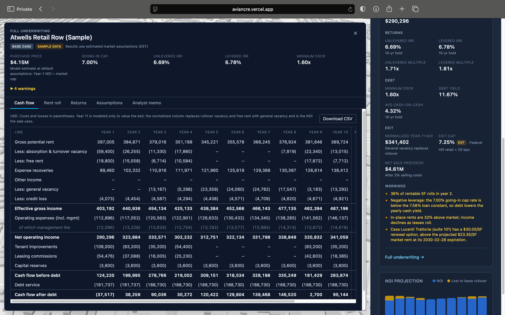
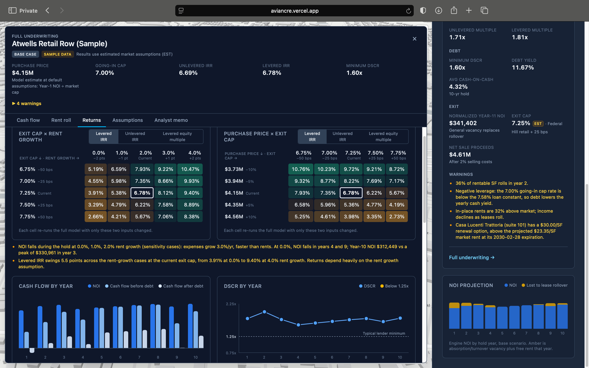
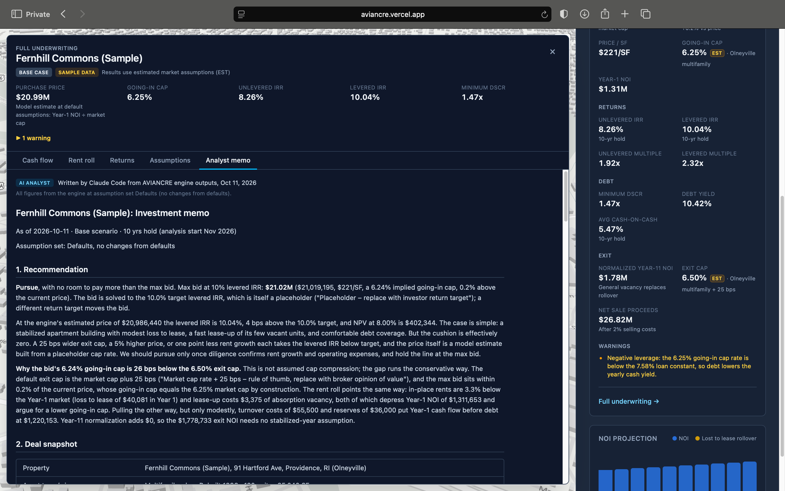

# AVIANCRE

**A bird's-eye view of Providence commercial real estate, from 3D map to underwriting.**

**Live:** https://aviancre.vercel.app

AVIANCRE puts Providence, RI on a 3D map and takes a property from first click to an
investment committee memo. Click any building to pull its public record (tax roll,
zoning, flood zone), then open a sample property or import a rent roll to underwrite it:
a lease-by-lease 10-year cash flow model, sensitivity grids, a max bid solved to a
target IRR, and an AI analyst memo written from the engine's output. It runs entirely in the browser: no backend, no accounts,
and an imported rent roll never leaves the user's machine.

## Screenshots

| | |
|---|---|
|  |  |
|  |  |
|  | |

**Demo video:** [watch the 2-minute demo](https://youtu.be/-qvyq65yE5A)

## What it does

- **3D map and public records.** Click any building in Providence for its live record:
  owner, land use, assessed value and taxes from the city's 2025 tax roll; year built,
  building and land area, base zoning, overlay and historic districts and the parcel
  outline from the city's parcel/zoning layer; flood zone and base flood elevation from
  RIGIS's FEMA flood map.
- **Address search.** Type-ahead over every city parcel address, the sample properties
  and imported deals; picking one flies there and opens its record.
- **Filters.** Asset type, size, occupancy, lease expiration, submarket, levered IRR and
  max bid vs price, synced between map and list and shareable in the URL.
- **Four persona views** of the same property: Analyst, Broker, Developer and Investment.
- **Underwriting engine.** Commercial properties are modeled lease by lease, monthly:
  escalations, renewal-probability rollover (downtime, free rent, TI, leasing
  commissions), NNN / base-year / expense-stop recoveries, vacancy and credit loss,
  debt, and a sale on normalized Year-11 NOI. Apartments are modeled unit by unit, with
  loss to lease burning off at each roll, turnover costs and lease-up of vacant units.
  Outputs include IRR (levered and unlevered), equity multiple, cash-on-cash, DSCR, debt
  yield, WALT, NPV and plain-language warnings.
- **Live assumptions and saved cases.** Edit any assumption and every figure updates.
  Save edits as named assumption sets, switch between them, and export or import them as
  files.
- **Sensitivity grids and max bid.** Exit cap × rent growth and price × exit cap grids,
  every cell a full engine run. Max bid solves for the price that hits the target
  levered IRR.
- **Rent roll import.** Load a rent roll from CSV or Excel. Yardi "Rent Roll with Lease
  Charges" reports and plain apartment unit tables are converted automatically through a
  mapping screen, checked against the file's own totals, and nothing is guessed
  silently.
- **AI analyst memo.** A Claude Code skill runs the tests, exports the engine's results
  as JSON, reviews a 12-point checklist and writes an investment committee memo, shown
  in the app's *Analyst memo* tab. Every number in the memo is quoted from the engine;
  the AI interprets, it doesn't calculate.

## How it was validated

- **Three independent Excel models.** The engine's output was matched to the cent against
  separately built Excel models for:
  - Atwells Retail Row (retail, NNN)
  - Westminster Office Tower (office, base-year recoveries, vacant-suite lease-up)
  - Fernhill Commons (apartments, unit by unit and month by month: renewals vs turnover,
    loss to lease burning off, lease-up). The Fernhill model was built only from the written
    inputs, rules and rent roll, and matched all 185 annual and 1,140 monthly values
    ([`docs/validation/`](docs/validation/)).
- **Golden tests** freeze all three results and check every cash-flow line in every year
  within $1, plus price, loan, equity, sale proceeds, both IRRs, minimum DSCR and WALT
  (Fernhill also checks its loan schedule by year to the cent, and every return metric).
  They also run after an assumption edit and reset, and after importing the same rent
  roll from CSV and from Excel.
- **744 automated tests** (Vitest) across the engine, sensitivity, max bid, rent roll
  import and conversion, assumption sets, search, filters and the public-record clients.

## Data sources

| Data | Source |
|---|---|
| Tax roll (owner, land use, assessed value, taxes) | [Providence Open Data](https://data.providenceri.gov/), 2025 tax roll |
| Parcels, zoning, overlay and historic districts, building size | City of Providence ArcGIS Online, [`Parcel_Zoning_FL`](https://services6.arcgis.com/wv9mHoqblhTsnqdG/arcgis/rest/services/Parcel_Zoning_FL/FeatureServer) |
| Flood zone and base flood elevation | RIGIS, [FEMA DFIRM Statewide Flood Hazard Areas 2022](https://services2.arcgis.com/S8zZg9pg23JUEexQ/arcgis/rest/services/PLAN_DFIRM_Statewide_Flood_Hazard_Areas_2022/FeatureServer/1) |
| Basemap and 3D buildings | OpenStreetMap via [OpenFreeMap](https://openfreemap.org/) |

All sources are called straight from the browser.

> **Sample data.** The 11 sample properties sit on real Providence buildings, but their
> names, tenants, rents and leases are fictional. Market figures and underwriting
> assumptions are placeholders, labeled **EST** in the app with a note on what should
> replace each one. Public-record data is real.

## Tech stack

React 19 · TypeScript (strict) · Vite 7 · Tailwind CSS v4 · MapLibre GL JS · Zustand ·
SheetJS · Vitest · Claude Code (AI analyst and rent roll skills) · deployed on Vercel

## Run it locally

Requires Node.js 20.19+ (or 22+).

```bash
npm install
npm run dev     # open the printed localhost URL
npm test        # full test suite
```

More detail: [`docs/UNDERWRITING.md`](docs/UNDERWRITING.md) (engine, conventions,
validation) · [`ROADMAP.md`](ROADMAP.md) · [`DEPLOY.md`](DEPLOY.md)

Built by Henly Hiraldo · [LinkedIn](https://www.linkedin.com/in/henly-hiraldo-42801b296)
